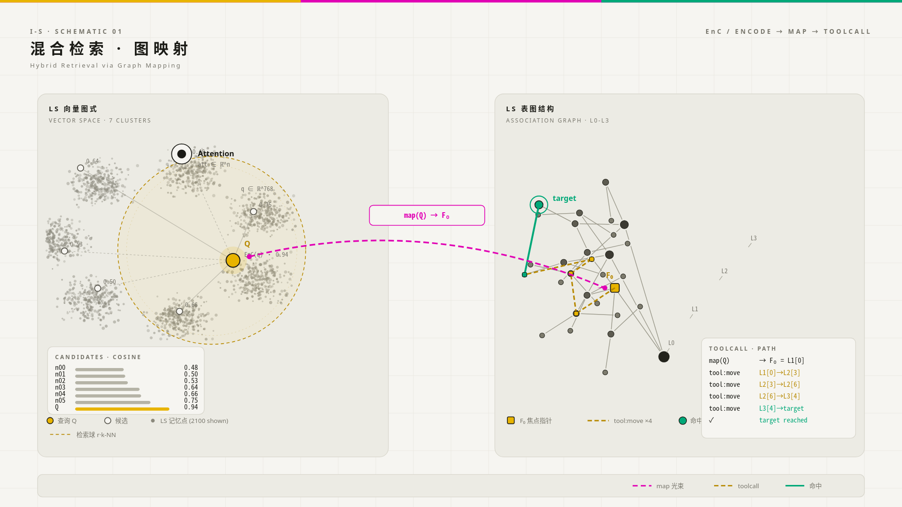

## 暂定名为I-S（Intent-Space）

## LS-Memory（Long Store Memory，长期记忆）
### 节点属性:

- **置信度**

- **来源**

- **时间**

- **检索权重**

### 节点间关系:

- **InferTo**（这导致了什么，全因） 

- **Halfcause**（这导致了什么，半因素/部分因素） 

- **CauseOf**（什么导致了它，全因） 

- **HalfCO** （什么导致了它，半因/部分因素或促成）

- **HappenCause**（原始因素，比如A-B-C-A的加强循环中，什么最先导致了此链条中的第一个循环，解决循环归因问题） 

- **About**（关于，例如AI和深度学习相关） 

- **MayA**（也许相关？） 

- **JUS**（只是因此而记住） 

这些是一个节点对于其他/另一节点的后继状态（即，一个节点是另一个节点的...，列如 今天下雨（P） 今天出门打了伞（Q） 之间有 **About** 和 **InferTo（P-Q）** 和 **CauseOf（Q-P）** 的关系）

规定一些 **数据输入源** ，列如Web,用户对话

## 常态思维
### 由 **Attention（Attention，注意力）** 和 **WS-Memory（workspace Memory，工作记忆）** 组成

###  **Attention** 决定了思维在思索时的
- **启发**（产生 要做一件事 的动机） 
- **导向**（通过什么来完成，完成的目的） 
- **谓词**（最终目的）

**Attention** 关注于 **I-S** 对 **所感兴趣** 以及 **意图** 的相关内容，它决定了什么可以进入 **WS-Memory**

模型推理时，拥有 **WS-Memory** 以及 **TLB（The thoughts left behind by what was done，遗留思想）** 以及 **BasicMemory**（由最基本的喜恶组成）作为提示词，并可借助 **WS-Memory** 的 **A（Attention）活动** 来获得 **LS中存在的相关内容** 。**WS,TLB,BaM** ，他们合称为 **NH-Memory**

**LS** 是潜在可被 **Attention** 激活的长期记忆，**WS** 是当前被激活的工作区。**NH-Memory** 则是单次行动思索的全部上下文

**TLB** 决定了 **I-S** 的 **Attention** 的一部分，**TLB** 驱动 **I-S** 执行 通过 **TLB所启发的Attention关注点** ，**I-S** 会因**TLB和BaM（BasicMemory）所反馈** 来强化 **BaM关注度（BaM中，对某件事的正负反馈）** 和获得**其他Attention点（注意力的转移与新导向）**

## 对记忆区的管理

单次思索的结果，**I-S** 会决定其价值并决定是否存入 **LS**

单次行动，思索的结果，外部的信息，会暂存入 **PWS（Pre Workspace Memory）**，如果 **I-S** 确信其有效或重要，那么它会进入 **WS** 

如果一个 **LS节点** 已经没用，例如 今天要下雨 但它是在昨日记录的，已经没用，那么它的检索权重会降低，最终被删除。（有一个 **有效LS节点** 依赖于 **此LS节点** 时除外，列如昨日记录的 今天要下雨 与 昨日记录的 今天被雨淋了很难过 有依赖关系）

## 关于未提及的长期展望行为：
在设想中 **BaM** 驱动了它，**BaM** 通过长期规划获得更多的正向反馈

而长期规划行为，借助 **WS** 获取的**全局LS快照或整体** 来思索

这实际是自发行为，而非设计的一部分，**I-S** 自身发展出了 **BaM** 中对长期计划的正向强化，并移动 **Attention** 到它上。

## EnC混合检索召回
将WS中的未记录记忆通过LS的向量图表示来映射至符号化表图结构中的记忆关联

向量图及符号化表图均为LS的一种节点关系表示方式

一张示意图。